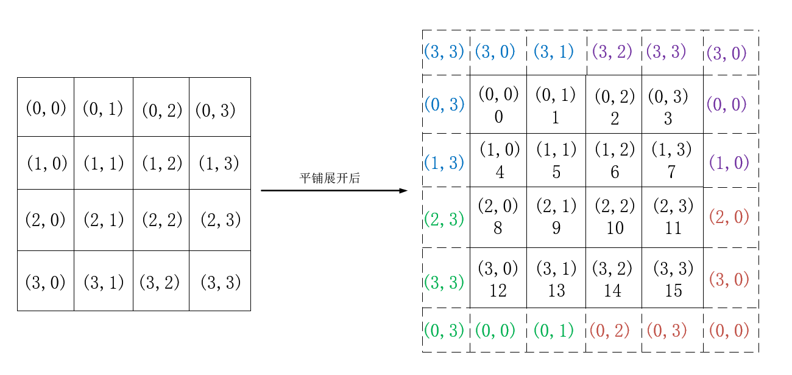
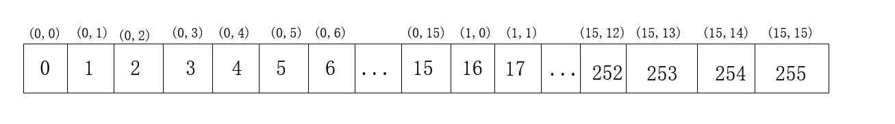

## 题目描述

Conway’s Game of Life is a two-dimensional cellular automaton.The “game” is played on a two-dimensional grid of cells, where each cell is either 1 (alive) or 0 (dead). At each time step, each cell changes state depending on how many neighbours it has:The game is formulated for an infinite grid. In this circuit, we will use a 16x16 grid. To make things more interesting, we will use a 16x16 toroid, where the sides wrap around to the other side of the grid. For example, the corner cell (0,0) has 8 neighbours: (15,1), (15,0), (15,15), (0,1), (0,15), (1,1), (1,0), and (1,15). The 16x16 grid is represented by a length 256 vector, where each row of 16 cells is represented by a sub-vector: q[15:0] is row 0, q[31:16] is row 1, etc. (This tool accepts SystemVerilog, so you may use 2D vectors if you wish.)The game state should advance by one timestep every clock cycle.John Conway, mathematician and creator of the Game of Life cellular automaton, passed away from COVID-19 on April 11, 2020.  
<!-- more -->

- 0-1 neighbour: Cell becomes 0.
- 2 neighbours: Cell state does not change.
- 3 neighbours: Cell becomes 1.
- 4+ neighbours: Cell becomes 0.
- load: Loads data into q at the next clock edge, for loading initial state.
- q: The 16x16 current state of the game, updated every clock cycle.

## 题目分析

康威的生命游戏，需要我们用verilog来实现，这道题目有些难度，一开始我也没有理解题目意思，查询了一些资料后，才大概清楚是怎么操作的。我们有一个16x16的网格，并且将其变成了一个环状的图形，我们需要遍历每一个格子并且判断与当前格子相近的格子中细胞的个数，并且有1表示细胞存活，0表示细胞死亡如果只有0或1个那么当前格子中的细胞死亡，如果是有2个细胞，则维持当前的状态。如果是有3个细胞，则当前格子中细胞存活，当出现4个以上的细胞，则当前格子中的细胞死亡。上述就是这个游戏的规则，其中如何找出那些格子是相近的，我觉得是比较绕和难的。题目中也给出了例子。



如图所示，每个格子对应一个坐标，由于是圆环状的将其平铺展开后，实际上是右边补全后的图形，这样一来各个点之间的相对位置也就清楚了。例如(0,0)处，与之相邻的就有8个点(3,3)、(3.0)、(3,1)、(0,3)、(0,1)、(1,3)、(1,0)、(1,1).搞清楚这个后，就是要解决如何判断细胞个数了，这个其实就比较容易了直接将对应点的内容进行相加再判断即可，由于每个点都有8个空与之相邻，假设其内的细胞都存活，总数的最大值也就是8，故我们可以定义一个3位宽的cnt变量，用来计算有多少细胞最后就是如何判断的问题了，这里其实可以划分成9块，分别是左上、右上、左下、右下、上边界、下边界、左边界、右边界和内部方块。（大致分三种情况，（1）中间部分 ，（2）四个角，（3）边缘行或列）另外我们还得知道另外因为我们是线性存储数据的，所以需要把坐标变成索引。



弄清楚这些后，这道题目其实就已经解决了，具体的看下列代码

- a. 行与行之间的差值是16 (16x16的网格)
- b. 列与列之间的差值是1，第一列到最后一列差值是15 (16x16的网格)

```verilog
module top_module(
    input clk,
    input load,
    input [255:0] data,
    output [255:0] q ); 
    
    reg		[2:0]	cnt;
    reg     [255:0] q_next;
    always @(*) begin
            for(int i=0;i<$bits(q);++i) begin
                if(i == 0)  //左上角
                    cnt = q[1] + q[16] + q[17] + q[15] + q[31] + q[240] + q[241] + q[255];
                else if(i == 15) //右上角
                    cnt = q[0] + q[14] + q[16] + q[30] + q[31] + q[240] + q[254] + q[255];
                else if(i == 240) //左下角
                    cnt = q[0] + q[1] + q[15] + q[224] + q[225] + q[241] + q[239] +q[255];
                else if (i == 255) // 右下角
                    cnt = q[0] + q[14] + q[15] + q[224] + q[238] + q[239] + q[240] + q[254];
                else if (i>0 & i <15) //上边界
                    cnt = q[i-1] + q[i+1] + q[i+15] + q[i+16] + q[i+17] + q[i+16*15-1] + q[i+16*15] + q[i+16*15+1];
                else if (i>240 & i<255) //下边界
                    cnt = q[i-1] + q[i+1] + q[i-15] + q[i-16] + q[i-17] + q[i-16*15-1] + q[i-16*15] + q[i-16*15+1] ;
                else if (i%16 == 0) //左边界
                    cnt = q[i+1] + q[i+1-16] + q[i+1+16] + q[i-16] + q[i+16] + q[i+15] + q[i+15-16] + q[i+15+16];
                else if (i%16 == 15) //右边界
                    cnt = q[i-1] + q[i-1-16] + q[i-1+16] + q[i-16] + q[i+16] + q[i-15] + q[i-15-16] + q[i-15+16];
                else //边界内
                    cnt = q[i-1] + q[i+1] + q[i+16] + q[i-16] + q[i+16+1] + q[i+16-1] + q[i-16-1] + q[i-16+1];
       		 case (cnt)
                 3'd0: q_next[i] = 1'b0;
                 3'd1: q_next[i] = 1'b0;
           		 3'd2: q_next[i] = q[i];
                 3'd3: q_next[i] = 1'b1;
                 default : q_next[i] = 1'b0;
        	endcase
         end
    end
    
    always @(posedge clk) begin
        if(load == 1'b1)
            q <= data;
        else
            q <= q_next;
    end

endmodule
```
